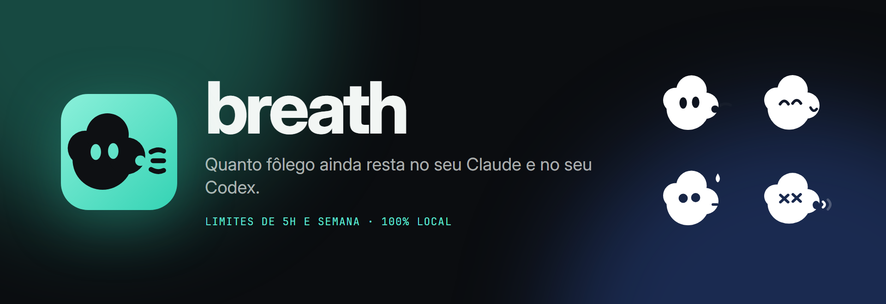
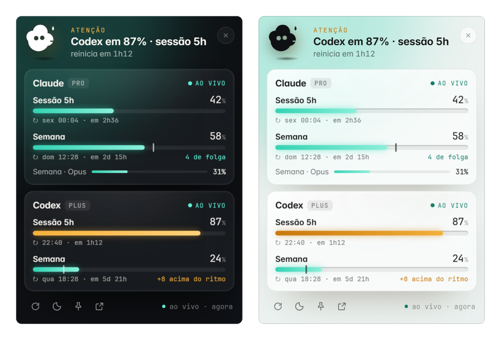

<p align="center">
  
</p>

<p align="center">
  <b>Os limites de sessão (5h) e semana do Claude Code e do Codex, num ícone ao lado do relógio do Windows.</b><br>
  100% local · sem dependências · sem telemetria
</p>

<p align="center">
  
</p>

---

## Para que serve

Quem usa o **Claude Code** (assinatura Pro/Max) e o **Codex** (assinatura ChatGPT Plus/Pro) esbarra em dois limites: a **sessão de 5 horas** e o **limite semanal**. Os dois apps só mostram isso quando você pergunta, ou quando já é tarde.

O Breath fica nos ícones ocultos da barra de tarefas. Um clique mostra, na hora:

- **Sessão (5h) e Semana** de cada um, em barras animadas, com porcentagem, horário de reinício e quanto falta.
- **Ritmo da semana:** um marcador na barra mostra onde você estaria se usasse a cota de forma uniforme ("5 de folga", "+8 acima do ritmo").
- **Limites por modelo**, quando a Anthropic informa (ex.: "Semana · Opus").
- **Várias contas:** tem mais de um login do Claude ou do Codex? Cada um ganha o seu cartão.
- **Avisos do Windows** quando um limite passa de 80% ou chega a 100%.
- **Resumo no ícone:** passe o mouse e veja `Claude 42% (sem. 58%) · Codex 87% (sem. 24%)`.

> Nem o Claude nem o Codex têm limite "diário": os dois usam uma janela móvel de **5 horas** e uma de **7 dias**. É isso que o Breath mostra.

## Conheça o Puff

O mascote do Breath é o **Puff**, uma nuvenzinha de ar que muda de humor conforme os seus limites:

| | | | |
|:-:|:-:|:-:|:-:|
| <br>tranquilo | <br>atenção (80%+) | <br>sem fôlego (100%) | <br>atualizado |
| <br>atualizando | <br>buscando | <br>sem login | <br>cota cheia |

## Privacidade e segurança

O Breath foi feito para rodar só na sua máquina, sem mandar seus dados para ninguém.

- **Sem servidor de terceiros.** Ele conversa só com `api.anthropic.com` e `chatgpt.com`, usando o login que o Claude Code e o Codex já guardam no seu computador. É a mesma consulta que esses apps fazem para mostrar o uso.
- **Seus tokens não saem do processo local.** O navegador recebe só porcentagens e horários; e-mail e IDs de conta são descartados.
- **Somente leitura.** O Breath nunca renova nem regrava seus arquivos de login (renovar poderia deslogar o Claude Code ou o Codex).
- **Só em `127.0.0.1`.** O painel não é acessível pela rede, e sites abertos no navegador não conseguem ler a API local.
- **Zero dependências.** Só a biblioteca padrão do Python. Nada de CDN, fontes externas ou analytics.

Detalhes técnicos em [SECURITY.md](SECURITY.md).

## Requisitos

- **Windows 10 ou 11** (o ícone na bandeja é do Windows; em macOS/Linux dá para usar só o painel no navegador)
- **Python 3.10+** ([python.org](https://www.python.org/downloads/) ou Microsoft Store)
- **Microsoft Edge** (já vem no Windows; é ele que desenha a janelinha)
- **Claude Code** logado com sua assinatura (`claude` no terminal) e/ou **Codex** logado com a conta ChatGPT

## Instalação

```powershell
git clone https://github.com/ggds12/breath.git
cd breath
```

Teste rápido (abre o ícone e a janelinha):

```powershell
python -m breath --show
```

Criar atalhos no Menu Iniciar e na Área de Trabalho, e iniciar junto com o Windows:

```powershell
powershell -ExecutionPolicy Bypass -File scripts\instalar-atalho.ps1 -AoIniciar
```

Pronto: o ícone fica nos **ícones ocultos** (a setinha `^` ao lado do relógio). Se quiser ele sempre visível, arraste-o para a barra.

Para remover os atalhos: `scripts\instalar-atalho.ps1 -Remover`. Para desinstalar, remova os atalhos e apague a pasta.

## Uso

| Ação | O que faz |
|---|---|
| Clique no ícone | Abre ou fecha a janelinha junto ao relógio |
| Clique fora, `Esc` ou ✕ | Fecha a janelinha |
| Botão de alfinete ou `F` | Mantém a janelinha aberta |
| `R` | Atualiza agora |
| `T` | Alterna tema claro/escuro |
| Clique direito no ícone | Abrir, painel completo no navegador, atualizar, sair |

Outros modos:

```powershell
python -m breath --no-tray     # só o servidor; abra http://127.0.0.1:7878
powershell -ExecutionPolicy Bypass -File scripts\stop.ps1   # encerra
```

Quer ver a interface sem conta nenhuma? Rode `python -m breath --no-tray` e abra `http://127.0.0.1:7878/?mini=1&demo=1`.

## De onde vêm os números

| Fonte | O que lê | Rede |
|---|---|---|
| Claude | `GET https://api.anthropic.com/api/oauth/usage` com o token de `~/.claude/.credentials.json` | Só Anthropic |
| Codex | `GET https://chatgpt.com/backend-api/wham/usage` com o token de `~/.codex/auth.json` | Só OpenAI |
| Codex, sem rede | Último `rate_limits` nos logs `~/.codex/sessions/**/rollout-*.jsonl` | Nenhuma |

Esses endpoints **não são APIs públicas documentadas**: são os que o próprio Claude Code e o Codex usam. Se mudarem, o Codex continua funcionando pelos logs locais, e o cartão do provedor avisa da falha.

A última leitura boa fica em `%LOCALAPPDATA%\Breath\ultima-leitura.json` (só porcentagens e horários), para a janelinha abrir já com dados.

## Várias contas

O Claude Code e o Codex guardam cada login numa pasta. Quem usa mais de uma conta normalmente troca de pasta com `CLAUDE_CONFIG_DIR` (Claude) ou `CODEX_HOME` (Codex). O Breath encontra essas pastas sozinho e mostra um cartão para cada conta:

- a pasta padrão (`~/.claude`, `~/.codex`) e a das variáveis de ambiente;
- qualquer pasta `~/.claude…` com login (ex.: `~/.claude-trabalho` vira **Claude · Trabalho**) e qualquer `~/.codex…` com login.

Para criar uma segunda conta do Claude, por exemplo:

```powershell
$env:CLAUDE_CONFIG_DIR = "$HOME\.claude-trabalho"; claude   # faça login com a outra conta
```

Quer nomes próprios ou pastas em outro lugar? Crie `%LOCALAPPDATA%\Breath\contas.json`:

```json
{
  "claude": [
    { "nome": "Pessoal",  "pasta": "~/.claude" },
    { "nome": "Trabalho", "pasta": "D:/logins/claude-trabalho" }
  ],
  "codex": [
    { "nome": "Pessoal", "pasta": "~/.codex" }
  ]
}
```

Se o arquivo listar um provedor, só as contas listadas dele aparecem. A janelinha cresce conforme o número de contas; se não couber na tela, a lista rola.

## Configuração

| Variável de ambiente | Padrão | Para quê |
|---|---|---|
| `BREATH_PORT` | `7878` | Porta local |
| `BREATH_LIMITS_TTL` | `60` | Segundos entre consultas às APIs de uso |
| `CLAUDE_CONFIG_DIR` | `~/.claude` | Pasta do Claude Code |
| `CODEX_HOME` | `~/.codex` | Pasta do Codex |

## Perguntas frequentes

**O ícone não aparece.** Abra a setinha `^` ao lado do relógio. Se ainda não estiver lá, rode `python -m breath` num terminal para ver a mensagem de erro.

**O cartão do Claude diz "login expirado".** Abra o Claude Code uma vez; ele renova o login sozinho e o Breath volta a ler.

**Aparece "a Anthropic pediu uma pausa".** A API devolveu HTTP 429 (muitas consultas). O Breath espera 5 minutos e tenta de novo, mostrando a última leitura enquanto isso.

**Tenho mais de uma conta do Claude (ou do Codex).** Veja [Várias contas](#várias-contas).

**Por que aparece um processo do Edge no Gerenciador de Tarefas?** A janelinha é uma página desenhada pelo Edge dentro de uma janela do próprio Breath. Para abrir na hora, sem piscar, o Breath prepara essa página escondida assim que inicia e a mantém pronta (algo como 100 MB de memória). Ela usa um perfil separado, sem acesso aos seus favoritos, senhas ou cookies.

**Funciona no macOS/Linux?** O servidor e o painel sim (`python -m breath --no-tray`); o ícone na bandeja e a janelinha são só do Windows.

**É oficial?** Não. O Breath é um projeto independente, sem vínculo com a Anthropic ou a OpenAI.

## Desenvolvimento

```powershell
python -m unittest discover -s tests -v
```

```
breath/              servidor e coletores (Python, só biblioteca padrão)
  providers/         claude.py, codex.py
  net.py             cliente HTTPS com lista fixa de hosts
  server.py          HTTP local, API /api/status, cabeçalhos de segurança
  tray.py            ícone na bandeja e janelinha (ctypes/Win32)
web/                 painel (HTML, CSS e JS sem framework), mascote e ícones
  accounts.py        descoberta das contas (várias por ferramenta)
tools/               make_brand.py (gera mascote, símbolo e favicon) e banner.html
scripts/             iniciar, encerrar e atalhos para Windows
tests/
```

A identidade visual é gerada por código: edite `tools/make_brand.py` e rode `python tools/make_brand.py`.

Contribuições são bem-vindas: abra uma issue ou um pull request.

## Licença

Código sob [MIT](LICENSE). A marca Breath, o mascote Puff, o símbolo e as imagens em `web/assets/` e `docs/` (exceto as fontes) têm todos os direitos reservados; se for redistribuir um fork, troque esses arquivos. As fontes Inter e JetBrains Mono seguem a SIL Open Font License.

---

<details>
<summary><b>English</b></summary>

**Breath** shows how much of your **Claude Code** (Pro/Max) and **Codex** (ChatGPT) usage limits you have left: the 5-hour session and the weekly window, as animated bars with reset times and a weekly pace marker. It lives in the Windows system tray; one click opens a small flyout next to the clock. Its mascot, Puff, gets out of breath when you hit a limit.

It runs entirely on your machine: Python standard library only, bound to `127.0.0.1`, read-only access to the logins Claude Code and Codex already store, and network calls only to `api.anthropic.com` and `chatgpt.com`. Tokens never reach the browser.

```powershell
git clone https://github.com/ggds12/breath.git
cd breath
python -m breath --show
powershell -ExecutionPolicy Bypass -File scripts\instalar-atalho.ps1 -AoIniciar   # shortcuts + start with Windows
```

Requires Windows 10/11, Python 3.10+ and Microsoft Edge. Not affiliated with Anthropic or OpenAI.
</details>
